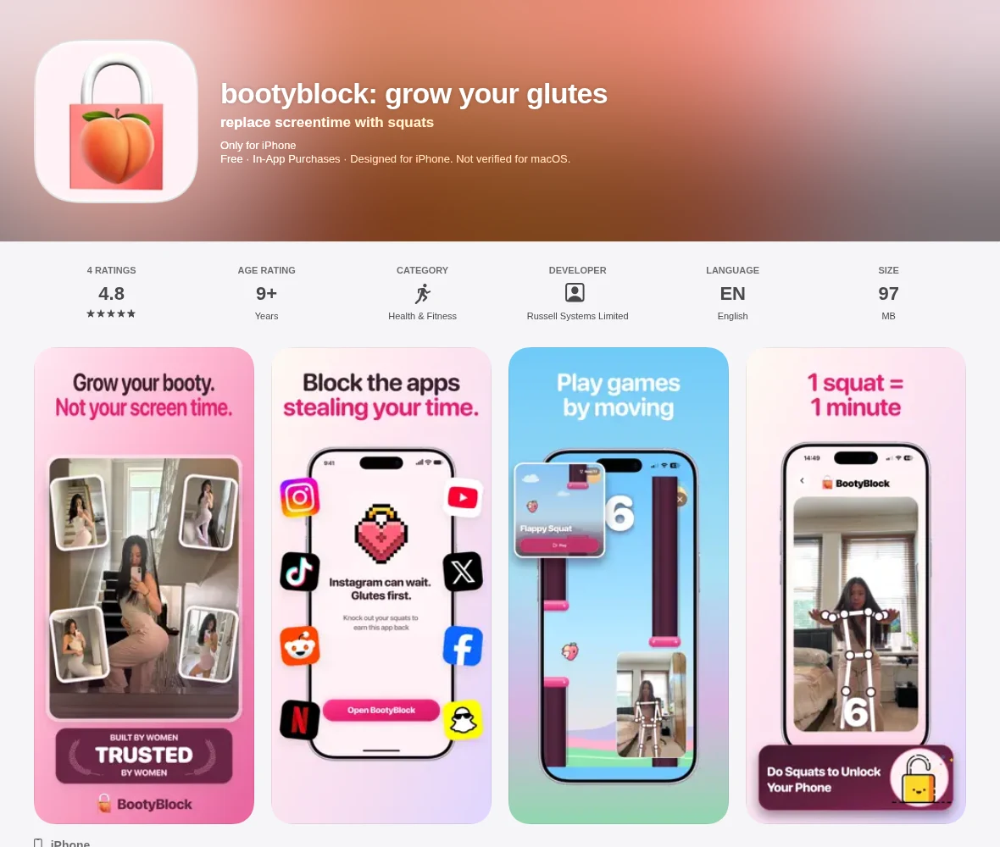
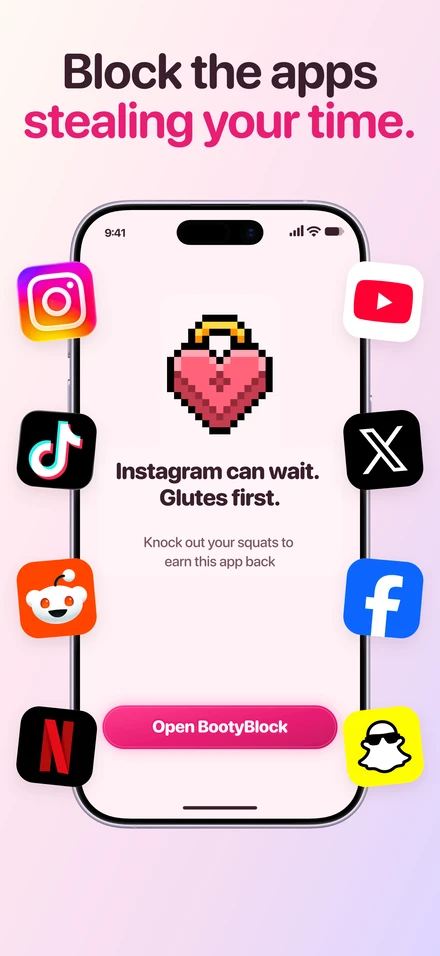
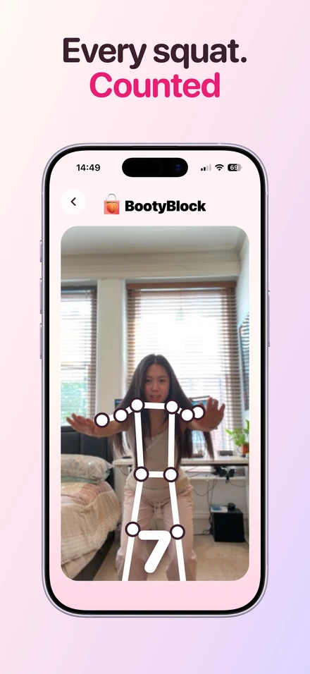
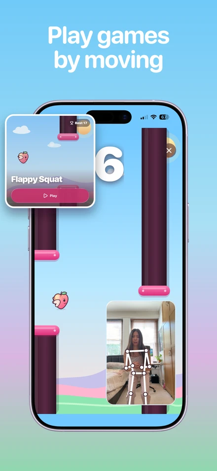

# BootyBlock

**Your screen time could be growing your glutes.**

BootyBlock turns the urge to scroll into a reason to move. Pick the apps that eat your day, and BootyBlock shields them until you earn your way back in: one squat, one minute of screen time. Your iPhone camera counts the reps, on device, with no video ever leaving the phone.

[**Download on the App Store**](https://apps.apple.com/gb/app/bootyblock-grow-your-glutes/id6782345701) · Free, with optional Pro subscription · iPhone, iOS 16.4+

<p align="center">
  
</p>

<p align="center">
  
  
  
</p>

## How it works

1. **Choose the apps that distract you.** BootyBlock uses Apple's Screen Time APIs to shield them.
2. **Do the squats.** The camera counts each rep with on-device pose estimation. Ten squats buys ten minutes.
3. **Spend your peaches.** Every squat earns a peach. Spend peaches to unshield an app, bank them for later, or play games with your body as the controller.

Because the work happens in the real world, the reward feels earned rather than taken.

## What's in the app

- **Screen Time shields** built on `FamilyControls`, `DeviceActivity` and `ManagedSettings`, with custom shield screens for each blocked app
- **On-device squat detection** — a custom Expo module wraps `AVFoundation` and Vision pose estimation, so frames are processed on the phone and never uploaded
- **Peaches, XP, levels and streaks** to make consistency feel like progress
- **Flappy Squat and Peach Hopper** — small games you play by squatting
- **Statistics** for reps, time earned, and streak history
- **Routines and reminders** so a session is easy to start
- **Pro** via RevenueCat, including a one-time launch offer

## Tech

| Piece | Choice |
| --- | --- |
| App | Expo SDK 56, React Native, Expo Router, NativeWind |
| iOS targets | `DeviceActivityMonitor`, `ShieldAction`, `ShieldConfiguration` extensions |
| Pose detection | Swift module (`modules/booty-pose`) over Vision + AVFoundation |
| Purchases | RevenueCat |
| Backend | Supabase for the landing waitlist |
| Analytics | PostHog |

```
app/            screens and routes
components/     UI
lib/            screen time, pose, purchases, games, progression
modules/        native Expo modules (pose, rolling number, TikTok)
targets/        iOS Screen Time extensions
ios/            native project and entitlements
supabase/       waitlist schema
landing/        marketing site and Cloudflare worker
```

## Running it

```bash
npm install
npx expo run:ios
```

You need:

- Xcode with an iOS 16.4+ simulator or device
- A development build (`expo run:ios`), not Expo Go — the Screen Time and camera modules are native
- An Apple developer team with the **Family Controls** entitlement, which Apple grants per app
- An App Group shared between the app and its extensions (`group.com.bootyblock.app`)

Copy `.env.example` to `.env.local` and fill in your own keys:

```bash
EXPO_PUBLIC_REVENUECAT_IOS_API_KEY=
EXPO_PUBLIC_REVENUECAT_ENTITLEMENT_ID=pro
EXPO_PUBLIC_POSTHOG_API_KEY=
EXPO_PUBLIC_POSTHOG_HOST=https://us.i.posthog.com
```

Without RevenueCat keys the paywall falls back to a local preview, and without PostHog the app simply skips analytics.

## Privacy

Camera frames are analysed on the device to count reps and are never stored or transmitted. The app collects purchase state and anonymous product analytics; it does not record video, audio, or screen content.

## Licence

See [LICENSE](LICENSE).
